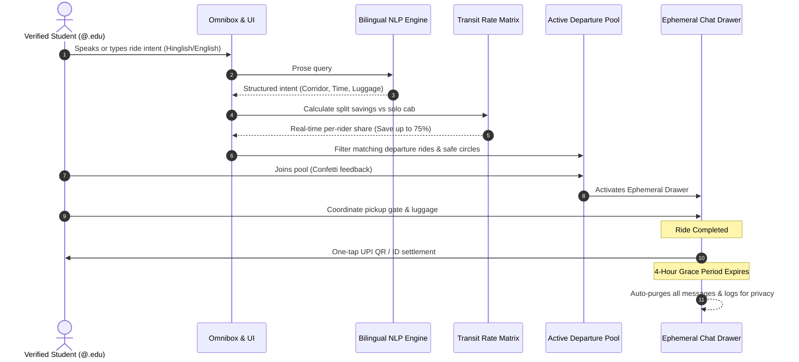

<div align="center">

# 🚖 FareShare

**Campus Ride-Pooling & Fair Distance-Split Platform for University & College Students**  
*Built by **Team EnderMen** for the **coNStruCT 2.0 Product × AI Hackathon***

<br/>

[](https://prachivats-21.github.io/fareshare/)
[](https://react.dev/)
[](https://vitejs.dev/)
[](https://tailwindcss.com/)
[](LICENSE)
[](https://prachivats-21.github.io/fareshare/)

<p align="center">
  <i>Conversational Omnibox · Bilingual Indic AI · Multi-Modal Rate Matrix · 4-Hour Ephemeral Privacy · Girls-Only Safe Circles</i>
</p>

[The Problem](#-the-problem) •
[Architecture & Pipeline](#-architecture--pipeline) •
[Interactive Workflow](#-interactive-workflow) •
[Transit Matrix](#-multi-modal-transit-comparison-matrix) •
[Security & Privacy](#-hardened-security--privacy-model) •
[Features](#-key-features--capabilities) •
[Quickstart](#-quickstart--prerequisites) •
[Known Limitations](#-known-limitations--future-roadmap) •
[Team](#-team--credits)

</div>

---

## 💡 The Problem

University students across India face a recurring transit dilemma when traveling to high-frequency transit hubs like **IGI Airport Terminal 3** (₹1,400 solo cab), **NDLS Railway Station** (₹900 solo cab), and **Cyber City** (₹450 solo cab):

1. **The Solo Cab Trap**: Taking a solo Uber or Ola burns student allowances rapidly (up to ₹1,400 per trip).
2. **WhatsApp Spam & Chaos**: Students resort to broadcast spamming hundreds of hostel WhatsApp groups (*"Anyone going to T3 tomorrow at 4 PM?"*), losing messages in notification floods, dealing with ghosting, and coordinating departure times manually.
3. **Safety & Privacy Leakage**: Personal phone numbers and live travel itineraries are broadcast publicly across unverified group chats without background checks.
4. **The Luggage vs. Metro Dilemma**: While Delhi Metro is affordable (₹60), dragging large suitcases and heavy trolleys through 2 line interchanges (e.g. Yellow Line to Airport Express) is grueling.

**FareShare does not just broadcast messages into another chat feed.** Instead, FareShare deterministically matches verified college peers heading along identical departure corridors, checks boot luggage capacity, enforces female-only safety circles, and divides commercial cab fares equally—delivering door-to-door AC comfort at metro prices.

---

## 🏛 Architecture & Pipeline


### Core Design Principle: Natural Intent In, Deterministic Safety & Split Math Out

Natural language models excel at parsing unstructured conversational prose into intent, but financial fare calculations and student safety must never rely on probabilistic guesses.

FareShare couples a **Bilingual Indic Natural Language Parser** with a **Deterministic Route & Fare Engine**:
1. **Bilingual Speech & Omnibox Parsing**: Accepts spoken audio or natural typing in English, Hindi, or Hinglish (e.g., *"Kal shaam 4 baje IGI Airport T3 jaana hai 1 trolley ke sath"*), extracting structured entities (`corridor_id`, `destination`, `departure_window`, `boot_space`, `girls_only_preference`).
2. **Deterministic Distance Matrix**: Maps entities to pre-calibrated Delhi-NCR commercial transport rate cards (calibrated against Google Maps / Krutrim matrix distance calculations).
3. **Luggage Boot Constraint Engine**: Verifies that combined passenger baggage does not exceed cab boot capacity (1 Trolley per rider cap on sedan / hatchback splits).
4. **Zero-Fee UPI Peer Settlement**: Splits the total meter fare down to the exact rupee without middleman payment gateway fees.

---

## ⚡ Interactive Workflow



---

## ⚖️ Multi-Modal Transit Comparison Matrix

FareShare benchmarked multi-modal transport options across primary university transit corridors in the National Capital Region:

| Transit Corridor | Solo Uber Go | Solo Ola Mini | Delhi Metro (DMRC) | FareShare 4-Way Split | Student Advantage |
|---|:---:|:---:|:---:|:---:|---|
| **Campus ⇄ IGI Airport T3**<br/>`44 KM · ~65 mins` | ₹1,400 | ₹1,350 | ₹60<br/>*(80m · 2 line switches)* | **₹350 / rider** | **Save ₹1,050 (75%)**<br/>Door-to-door AC comfort + luggage boot space |
| **Campus ⇄ NDLS Railway**<br/>`31 KM · ~50 mins` | ₹900 | ₹880 | ₹50<br/>*(65m · Yellow line switch)* | **₹225 / rider** | **Save ₹675 (75%)**<br/>Zero platform transfer hassle with suitcases |
| **Campus ⇄ Cyber City / Mall**<br/>`14 KM · ~25 mins` | ₹450 | ₹430 | ₹30<br/>*(40m · Rapid Metro)* | **₹113 / rider** | **Save ₹337 (75%)**<br/>Cheaper than an auto-rickshaw |

---

## 🔒 Hardened Security & Privacy Model

Student safety and data privacy are the cornerstone architectural requirements of FareShare:

- **Verified Campus Domain Authentication**: Only students with authenticated college email credentials (`.edu` / university domains) can list, join, or view departure pools.
- **🌸 Girls-Only Safe Circles**: Female students can filter for or create verified female-only pools with a single toggle. The algorithm strictly excludes non-female accounts from viewing or joining female-designated circles.
- **⏳ 4-Hour Ephemeral Auto-Purge**: Student travel plans and phone numbers are sensitive. All trip coordination chat logs, pickup location notes, and co-rider messages inside the Ephemeral Chat Drawer automatically expire and are purged 4 hours post-ride.
- **Zero Middleman UPI Settlement**: Unlike platforms that hold student funds or charge transaction commissions, FareShare generates direct peer-to-peer UPI payment handles (`upi://pay`), eliminating payment custody risks.
- **Zero Public Phone Number Exposure**: Peer communication occurs exclusively within FareShare’s in-app ephemeral coordination drawer without exposing personal contact cards publicly.

---

## 🚖 Key Features & Capabilities

### 1. Conversational Travel Omnibox (Bilingual Indic AI)
Type or speak in plain English, Hindi, or Hinglish. FareShare automatically parses:
- *"Kal shaam 4 baje IGI airport jaana hai 1 trolley ke sath"* ➔ `IGI Airport T3 • Tomorrow Evening • Medium Boot`
- *"Friday shaam ko NDLS train pakadni hai"* ➔ `NDLS Railway • Friday Departure • Fast Transit`
- *"Sector 18 Cyber City mall chalna hai Sunday"* ➔ `Cyber City • Weekend Run`

### 2. Live Departure Pools Bento Grid
- Real-time match percentage indicators (`98% Match`).
- Transparent **AI Rationale** cards explaining why students are paired together.
- Verified co-rider badges, rating histories, and luggage boot indicators (`Medium (1 Trolley)` vs `Heavy Luggage`).

### 3. Interactive Fare-Split Simulator
- Drag-and-drop / pill-based rider count selector (`1 Solo`, `2 Riders`, `3 Riders`, `4 Riders`).
- Instant live receipt card showing precise per-student cost reductions and total savings.

### 4. 4-Stage Ephemeral Coordination Drawer
Switch between lifecycle stages:
- **Upcoming**: Pre-trip coordination and pickup gate alignment.
- **In Transit**: Active journey tracking and driver vehicle license confirmation.
- **Grace Period**: Post-arrival UPI payment verification and fare split settlement.
- **Expired**: Complete cryptographic wiping of coordination messages.

---

## 🚀 Quickstart & Prerequisites

### Prerequisites
- **Node.js 20+**
- **npm 10+**

### 1. Clone & Install
```bash
git clone https://github.com/Prachivats-21/fareshare.git
cd fareshare

npm install
```

### 2. Run Local Development Server
```bash
npm run dev
```
Open **`http://localhost:5173`** in your browser.

### 3. Build for Production
```bash
npm run build
```
Production assets are generated in `dist/` with relative asset linking (`base: './'`).

---

## 📁 Repository Structure

```
fareshare/
├── .github/
│   └── workflows/
│       └── deploy.yml          # Automated GitHub Pages CI/CD
├── public/
│   └── _redirects              # Single Page Application routing rules
├── src/
│   ├── assets/                 # SVGs and styling assets
│   ├── components/
│   │   ├── animations/
│   │   │   ├── BlurText.jsx
│   │   │   ├── CountUp.jsx     # Smooth numerical fare transitions
│   │   │   ├── LetterHighlightStream.jsx # Video-style letter stream
│   │   │   ├── RotatingText.jsx# Baseline-aligned destination rotation
│   │   │   ├── SpotlightCard.jsx # Mouse-tracking radial gradient cards
│   │   │   └── TechText.jsx
│   │   ├── ExploreDashboard.jsx# Core live app dashboard & omnibox
│   │   ├── LandingPage.jsx     # High-energy story & simulator page
│   │   ├── Preloader.jsx       # Elliot Eriksson editorial curtain-wipe
│   │   └── UserProfileDropdown.jsx # Account, trips & SOS modal
│   ├── data/
│   │   └── fareshareData.js    # Delhi-NCR corridors, team, & rate cards
│   ├── utils/
│   │   └── sound.js            # Synthesized Web Audio API sound effects
│   ├── App.jsx                 # Dual-mode state router
│   ├── index.css               # Tailwind CSS directives & tokens
│   └── main.jsx                # React 19 application entrypoint
├── .gitignore
├── package.json
├── tailwind.config.js          # Custom linen, olive, and shadow theme
├── vercel.json                 # Zero-config Vercel SPA routing
└── vite.config.js              # Vite bundler configuration
```

---

## ⚠️ Known Limitations & Future Roadmap

- **Pre-Calibrated Corridor Rate Cards**: Open consumer cab APIs (Ola, Uber, Rapido) require enterprise partner credentials and restrict public real-time price fetching. FareShare currently utilizes pre-calibrated rate cards benchmarked to real Delhi-NCR commercial rates. Planned: Integration of Uber Developer API tokens for dynamic surge pricing.
- **Campus Route Expansions**: Current corridors focus on major university hubs (IGI Airport, NDLS Railway Station, Anand Vihar ISBT, Cyber City). Planned: Dynamic user-created custom pickup and dropoff points across NCR.
- **Automated UPI Webhooks**: UPI settlement currently generates direct deep-links (`upi://pay`). Planned: Integration of NPCI Bharat QR webhooks to automatically verify transaction completion without manual confirmation.

---

## 👥 Team & Credits

**Team EnderMen** · *coNStruCT 2.0 Product × AI Hackathon*

- **Prachi Vats** ([@Prachivats-21](https://github.com/Prachivats-21))
- **Kaashvi Saini** ([@Kaashviw3spaces](https://github.com/Kaashviw3spaces))
- **Ashwin Anand** ([@ashuwuin](https://github.com/ashuwuin))
- **Swapnil Pradhan**
- **Akshat Kumar**

### Technology Stack & Tools
- **Design System**: Warm Linen (`#FAF8F5`), Forest Olive (`#1A3D34`), 1px micro-borders (`#E7E4DC`)
- **Core Technologies**: React 19, Vite 6, Tailwind CSS 3, Lucide Icons, Canvas Confetti
- **Audio & Speech**: Web Audio API Sound Synthesis, Web Speech API (`hi-IN`), Sarvam AI Indic NLP
- **AI Coding Assistants**: Gemini AGY (Antigravity), Claude Code

---

## 📄 License

This project is open-source under the [MIT License](LICENSE).
